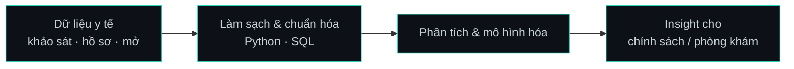

<div align="center">
  

  
</div>

```bash
$ whoami
> TÊN BẠN — Medical Information Systems @ UIT, ĐHQG TP.HCM

$ cat focus.txt
> health data · analytics · clinical software

$ ls ~/now
> building/   learning/   reading/
```

- 🔭 **Đang làm:** [Tên dự án](https://github.com/<username>/<repo>) — mô tả 1 dòng
- 🌱 **Đang học:** Python · SQL · *(FHIR / HL7 nếu bạn thật sự đang học)*
- 📫 **Liên hệ:** [LinkedIn](https://linkedin.com/in/<id>) · [Website](https://<your-site>)

---

### 🧪 Dự án tiêu biểu

| Dự án | Bài toán | Kết quả / Công nghệ |
|---|---|---|
| [**Tên repo 1**](https://github.com/<username>/<repo1>) | 1 câu về vấn đề thật | số liệu hoặc kết quả cụ thể · Python |
| [**Tên repo 2**](https://github.com/<username>/<repo2>) | … | … |
| [**Tên repo 3**](https://github.com/<username>/<repo3>) | … | … |

> Chỉ liệt kê dự án đã có repo và README. Dòng trống tốt hơn một dự án chưa tồn tại.

### 🏥 Cách mình làm việc với dữ liệu y tế



### 🎮 Loadout

| Slot | Trang bị |
|---|---|
| 🎯 **Primary** |  |
| 🔫 **Secondary** |  |
| 🧰 **Utility** |   |

### 📊 Hoạt động

<div align="center">
  &show_icons=true&hide_border=true&bg_color=0d1117&title_color=2dd4bf&icon_color=2dd4bf&text_color=c9d1d9" />
  &layout=compact&hide_border=true&bg_color=0d1117&title_color=2dd4bf&text_color=c9d1d9" />
  <br/><br/>
  <picture>
    <source media="(prefers-color-scheme: dark)" srcset="https://raw.githubusercontent.com/<username>/<username>/output/github-snake-dark.svg" />
    /<username>/output/github-snake.svg" />
  </picture>
</div>

<div align="center">
  
</div>
