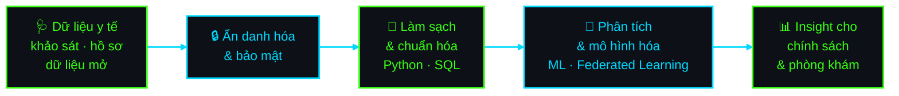

<!--
  ╔═══════════════ CẦN THAY TRƯỚC KHI ĐĂNG (Ctrl+H → Replace all) ═══════════════╗
    <username>     → tên tài khoản GitHub của bạn (xuất hiện nhiều chỗ)
    <fl-ids-repo>  → tên repo đồ án FL-IDS
    <linkedin-id>  → ID LinkedIn (phần sau linkedin.com/in/)
    <email>        → email liên hệ
    Mục "Nghiên cứu khoa học" → điền thông tin bài của bạn
  ╚═══════════════════════════════════════════════════════════════════════════════╝
-->

<div align="center">

  

  <!-- Muốn đổi dòng chữ chạy: sửa trên https://readme-typing-svg.demolab.com/demo/ rồi dán link mới vào đây -->
  <a href="https://github.com/DenverCoder1/readme-typing-svg"></a>

  <p>
    &label=L%C6%AF%E1%BB%A2T%20XEM&color=39ff14&style=for-the-badge" alt="Lượt xem trang" />
    <a href="https://linkedin.com/in/<linkedin-id>"></a>
    <a href="mailto:<email>"></a>
    <a href="#research"></a>
  </p>

</div>

### 💻 `~/whoami`

```console
minh@uit:~$ whoami
Minh Thanh — Medical Information Systems @ UIT, VNU-HCM

minh@uit:~$ cat focus.txt
health data · privacy-preserving ML · clinical software

minh@uit:~$ ls ~/now
building/   learning/   research/

minh@uit:~$ ./vitals --check
[ OK ] curiosity ........... 100%
[ OK ] caffeine ............ 87%
[WARN] sleep ............... low (deadline season)
```

- 🔭 **Đang làm:** [FL-IDS](https://github.com/<username>/<fl-ids-repo>) — Federated Learning cho hệ thống phát hiện xâm nhập phân tán
- 📄 **Nghiên cứu:** xem mục [Nghiên cứu khoa học](#research) bên dưới
- 🌱 **Đang học:** Python · SQL · PyTorch <!-- thêm FHIR / HL7 nếu bạn thật sự đang học -->
- 📫 **Liên hệ:** [LinkedIn](https://linkedin.com/in/<linkedin-id>) · [Email](mailto:<email>)


### 🧪 `~/projects` — Dự án tiêu biểu

| Dự án | Bài toán | Công nghệ · Kết quả |
|---|---|---|
| [**FL‑IDS**](https://github.com/<username>/<fl-ids-repo>) | Phát hiện tấn công mạng khi dữ liệu nằm rải rác ở nhiều nơi: các máy khách cùng huấn luyện một mô hình chung mà **không gửi dữ liệu thô** về máy chủ | Python · PyTorch · CICIDS2017 · ToN-IoT<br/>📈 *Kết quả: (điền Accuracy / F1 sau khi chạy thực nghiệm)* |

> [!TIP]
> Federated Learning cũng là hướng tiếp cận được quan tâm trong y tế: nhiều bệnh viện có thể cùng huấn luyện mô hình mà không phải chia sẻ hồ sơ bệnh nhân ra ngoài.

<!-- Thêm dự án: chỉ liệt kê dự án đã có repo và README. Mẫu một dòng:
| [**Tên repo**](https://github.com/<username>/<repo>) | 1 câu về vấn đề thật | Công nghệ · số liệu cụ thể |
-->

<a name="research"></a>

### 📄 `~/research` — Nghiên cứu khoa học

<!-- Điền thông tin bài của bạn vào cột bên phải, xóa phần chữ nghiêng trong ngoặc -->

| Mục | Nội dung |
|---|---|
| 📝 **Tên bài** | *(điền tên bài nghiên cứu)* |
| 👥 **Tác giả** | *(điền danh sách tác giả)* |
| 🏛️ **Nơi công bố** | *(hội nghị / tạp chí / kỷ yếu — năm)* |
| 🔗 **Liên kết** | *(DOI / PDF / Google Scholar)* |
| 🧭 **Tóm tắt** | *(1–2 câu: bài toán → phương pháp → kết quả chính)* |

### 🏥 `~/pipeline` — Cách mình làm việc với dữ liệu y tế



### 🎮 `~/inventory` — Loadout

| Slot | Trang bị |
|---|---|
| 🎯 **Primary** |  |
| 🔫 **Secondary** |  |
| 🧪 **Special** |  |
| 🧰 **Utility** |   |

<!-- Đang học FHIR / HL7 thật thì thêm dòng:
| 🔒 **Đang mở khóa** |  |
-->

### 📊 `~/stats` — Hoạt động

<div align="center">

  
  

  <a href="https://github.com/DenverCoder1/github-readme-streak-stats">&locale=vi&hide_border=true&background=0D1117&stroke=30363D&ring=39FF14&fire=00D9FF&currStreakNum=39FF14&currStreakLabel=39FF14&sideNums=C9D1D9&sideLabels=00D9FF&dates=8B949E" alt="Chuỗi ngày đóng góp" /></a>

  <picture>
    <source media="(prefers-color-scheme: dark)" srcset="https://raw.githubusercontent.com/<username>/<username>/main/profile/snake-dark.svg" />
    <source media="(prefers-color-scheme: light)" srcset="https://raw.githubusercontent.com/<username>/<username>/main/profile/snake-light.svg" />
    /<username>/main/profile/snake-dark.svg" />
  </picture>

  <sub>Thẻ thống kê và con rắn được GitHub Actions tự cập nhật mỗi ngày.</sub>

</div>

<div align="center">
  
  
</div>
